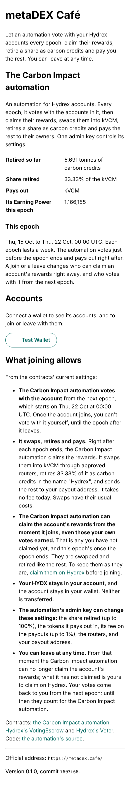
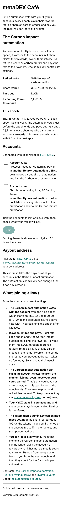
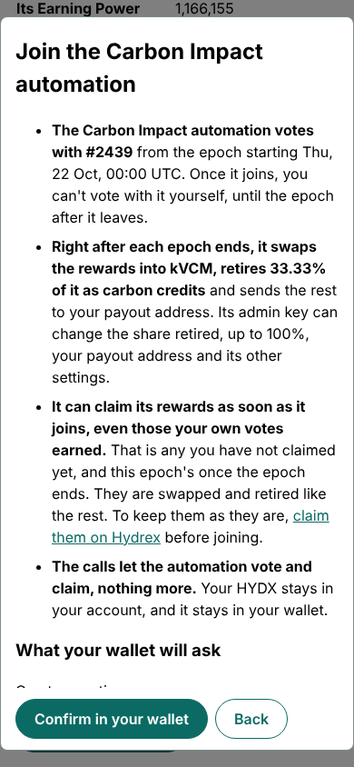

# 1. The site today

An inventory and heuristic review of <https://metadex.cafe/> at version 0.1.0 (commit `7603f66`), built from this
repository and driven in Chromium with a test wallet at 390 and 1440 px, with the accounts of a real owner on Base
(`0x6970…a655`: one Protocol Account in the USDC automation, one Flex Account in Hydrex Lock Maxi, both automations
Hydrex has since disabled).

## What is there

One page, read top to bottom, with no navigation:

| Order | Section                      | Shows                                                                                                       |
| ----- | ---------------------------- | ----------------------------------------------------------------------------------------------------------- |
| 1     | Header                       | Name, and one sentence on what the automation does                                                          |
| 2     | The Carbon Impact automation | What it does; tonnes retired so far, share retired, payout token, its Earning Power this epoch              |
| 3     | This epoch                   | The epoch's dates, when the automation votes and pays, and when a join or leave takes effect                |
| 4     | Accounts                     | Wallet buttons; once connected, each account with its kind, Earning Power and status, ticks, Join and Leave |
| 5     | Payout address               | Where payouts go, once connected                                                                            |
| 6     | What joining allows          | Six disclosures, then links to the contracts and the source                                                 |
| 7     | Footer                       | The official address, version and commit                                                                    |
| —     | Review dialog                | What the join or leave changes, then the exact calls, then Confirm                                          |

Measured on the page with no wallet connected:

| Measure                                                    | 390 × 844 (phone)      | 1440 × 900 (desktop)   |
| ---------------------------------------------------------- | ---------------------- | ---------------------- |
| Page height                                                | 2,372 px (2.8 screens) | 1,664 px (1.8 screens) |
| Top of the first wallet button                             | 994 px: below the fold | 718 px                 |
| Words before the wallet buttons                            | about 170              | about 170              |
| Words on the page                                          | about 440              | about 440              |
| Mentions of "the Carbon Impact automation" in `index.html` | 23                     |                        |

| First visit, 390 px                           | Connected, 390 px                         | Review, 390 px                      |
| --------------------------------------------- | ----------------------------------------- | ----------------------------------- |
|  |  |  |

## What works, and must survive any reorganisation

1. **Honesty about what joining allows.** The page states the surprising consequence in bold: the automation can claim
   rewards the owner's own votes earned, and it says how to avoid it (claim on Hydrex first). It names the admin key and
   what it can change. This is rarer than it should be in DeFi and is the page's main trust asset.
2. **A narrow, checkable surface.** Two calls only, decoded in the review before the wallet asks; startup checks of the
   contracts that turn joining off but keep leaving on; the official address in the footer; a reproducible build.
3. **Leaving always works.** Even when a check fails. Users trust a door they can see.
4. **Rich per-account status.** In, joined (from next epoch), left (until this epoch ends), partly in, in another
   automation (by name), delegated elsewhere, voting itself, lock ended, empty. Few dApps model this many states.
5. **Wallet and Safe coverage.** EIP-6963 wallets, a fallback, in-wallet browsers, and Safe{Wallet} as a Safe App, with
   a review that adapts ("Propose in Safe{Wallet}").
6. **Accessible foundations.** Semantic HTML, `role="alert"` and `role="status"`, visible focus, 44 px targets, light
   and dark, no horizontal scroll at 390 px.

## Problems

Rated by how much they hurt the people in [the personas](2-personas.md), some found only once Hydrex's own app and its
stopped automations were compared: **high** blocks a decision or a task, **medium** slows it or erodes trust, **low** is
friction.

| #   | Severity | Problem                                                                                                                                                                                                                                                                                                                                                                                                                                                                             | Heuristic                         |
| --- | -------- | ----------------------------------------------------------------------------------------------------------------------------------------------------------------------------------------------------------------------------------------------------------------------------------------------------------------------------------------------------------------------------------------------------------------------------------------------------------------------------------- | --------------------------------- |
| P1  | High     | **Accounts in stopped automations look fine.** An account in another automation reads "In another Hydrex automation: USDC. Joining takes it out of that automation and into the Carbon Impact automation." Hydrex has disabled its automations, and about 11.5 M Earning Power still points at the 13 that no longer run. For most visitors this is the most important line on the page, and it leaves out the one thing they need to know: nothing runs for this account any more. | Visibility of system status       |
| P2  | High     | **Learning and doing share one scroll.** A first-time visitor gets the mechanics before the reason; a returning member must scroll past the same explanation every time to check status or leave. On a phone the wallet button is below the fold.                                                                                                                                                                                                                                   | Flexibility and efficiency of use |
| P3  | High     | **No answer to "why this, and what do I get?"** With Hydrex's automations stopped, the alternatives are voting by hand every week or leaving the votes where they are; the page compares with neither. It says the automation pays in kVCM, but not what kVCM is, what it is worth, or what a member earned last epoch.                                                                                                                                                             | Match with the real world         |
| P4  | High     | **The cost of the impact is left for the user to work out.** "Share retired: 33.33% of the kVCM" means a third of the rewards are given up. The page never says it in those words, nor what it buys: tonnes per epoch, per account, or for this user.                                                                                                                                                                                                                               | Visibility of system status       |
| P5  | Medium   | **The disclosures sit after the action and repeat in the review.** "What joining allows" comes after the Join button and is restated, almost word for word, in the review. On the page it is a wall of six bold-led bullets that most visitors will skip; in the review it competes with the calls.                                                                                                                                                                                 | Aesthetic and minimalist design   |
| P6  | Medium   | **The account list reads as prose, not as a dashboard.** There is no summary (how many accounts, how much Earning Power, how many already in), no grouping by status, and one Join and one Leave for whatever is ticked. The Join button shows disabled until a tick, with no hint that the rows are the controls.                                                                                                                                                                  | Recognition rather than recall    |
| P7  | Medium   | **The timing is the hardest idea and gets one paragraph.** Claims move at once; votes move next epoch; the automation votes just before the epoch ends and pays right after. There is no countdown, no timeline, and the statuses "Joined" and "Left" depend on it.                                                                                                                                                                                                                 | Visibility of system status       |
| P8  | Medium   | **Nothing to come back for.** No payout history, nothing earned or retired per account, no next payout; the page cannot show that payouts happen (README, Limitations). Hydrex's account view used to show "Next payout" and "Automation History"; with its automations disabled, nothing shows a member what happened. Impact, the reason to join, is invisible after joining.                                                                                                     | Feedback                          |
| P9  | Medium   | **Carbon, the differentiator, is the least explained part.** "Retires … as carbon credits in the name Hydrex": which credits, where to see the retirement, why the name is Hydrex and not the member. kVCM, Klima and carbon credits are new words to most Hydrex users.                                                                                                                                                                                                            | Help and documentation            |
| P10 | Medium   | **Trust is shown to engineers only.** Contract links, code, the official address and the commit serve someone who reads Solidity. There is nothing on who runs the automation, who holds the admin key, audits, or where to ask a question.                                                                                                                                                                                                                                         | Help and documentation            |
| P11 | Medium   | **The most common Hydrex wallet may find nothing to connect.** Hydrex recommends "Sign in with Base" (Coinbase Smart Wallet) and WalletConnect, and runs as a Base and Farcaster mini app. The page finds wallets the browser announces and `window.ethereum`: a holder on a phone, outside a wallet app's own browser, is told that no wallet was found, and to install one or reopen the page in a wallet app.                                                                    | Flexibility; error prevention     |
| P12 | Medium   | **What others publish about the automation is out of date, and the page does not say it is the reference.** Hydrex's API still lists Carbon Impact as paying "60% kVCM, 40% AZUSD", though AZUSD no longer works and the automation no longer claims it. Hydrex's app said a change of automation takes effect "after the next payout"; the page says claims move at once and votes from the next epoch.                                                                            | Consistency and standards         |
| P13 | Low      | **The payout address reads as a warning.** A full address, then "the admin key can change it, as it can any owner's", with no way to act on it.                                                                                                                                                                                                                                                                                                                                     | Error prevention                  |
| P14 | Low      | **Mixed vocabulary.** Hydrex's words (Account, Earning Power, Flex, Protocol) are right for this audience; contract words (VotingEscrow, Voter, routers, admin key) and carbon words (retire, kVCM) appear unexplained alongside them.                                                                                                                                                                                                                                              | Match with the real world         |
| P15 | Low      | **No way in without a wallet.** A Safe signer on another device, or someone checking a friend's or a DAO's accounts, cannot look an address up read-only.                                                                                                                                                                                                                                                                                                                           | Flexibility                       |

## What this means for the organisation

P1 can be fixed in any organisation: it is a status line. Most of the other high and medium problems are not about
wording: they come from one page serving several different visits with one order of content.

- **Deciding** (first visit): needs the why, the numbers to compare, the cost and the risk, in that order, before any
  wallet.
- **Moving** (a holder whose Hydrex automation stopped): needs to learn that it stopped and what that means for the
  account, then the same as deciding.
- **Acting** (join or leave): needs the accounts, their status and the effect of the change, as fast as possible, with
  the disclosures at the moment of the decision.
- **Checking** (return visits): needs status, what happened last epoch and what happens next, then out.

The options in [4. Organisations](4-organisations.md) are different ways to separate those visits.
